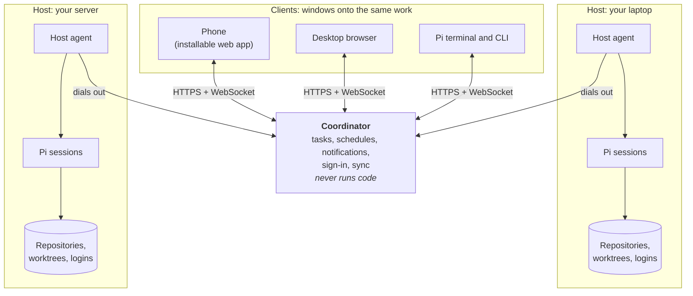
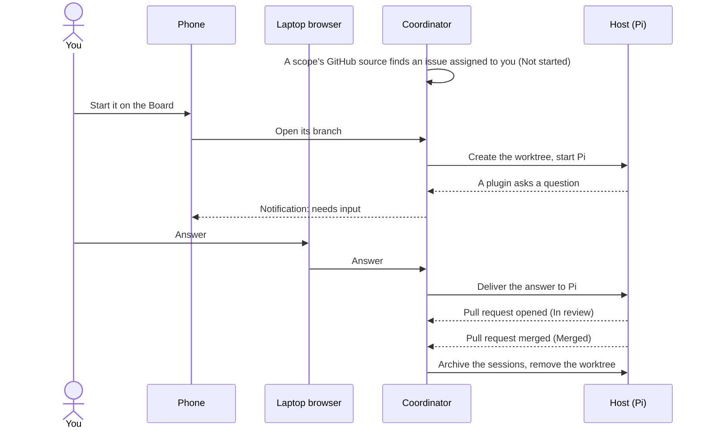

# Switchyard

**Run [Pi](https://github.com/earendil-works/pi) coding agents on your own machines, and drive them from your phone, your browser or your terminal.**

Website and documentation: **https://switchyard-site.pages.dev**

A coding agent has to run where your repositories, toolchains and logins are: your laptop, a workstation, a home server. You, on the other hand, are not always sitting in front of that machine. Switchyard keeps the agents where the work is and lets you follow along from anywhere: start a session from your phone, answer the question it asks while you are on your laptop, take over from a terminal, and get a notification when the result is ready for review. Every client looks at the same live session, and closing one never stops the work.

Switchyard tracks what you are working on as branches: each has a worktree and one agent session, wherever it runs, and the issues, pull requests and board columns that go with it. On top of that it adds scopes fed by your GitHub issues, scheduled automations and a review flow, so an agent can work through a backlog while you are away and hand everything back for you to accept. Switchyard aims to preserve continuity with your evolving Pi setup: plugins own their workflows and optional adapters translate supported interactions, not arbitrary custom terminal UIs. See [plugin ownership](docs/plugin-boundaries.md).

## How it fits together



There are three kinds of parts:

- **The coordinator** is the one always-on service. It keeps tasks, schedules, notifications, devices and the shared view of every session, and it decides what runs where. It never runs an agent and never holds your provider credentials, so it can live anywhere: a container, a small server, or your laptop.
- **Hosts** are your machines. A host agent runs Pi as your OS user, with your repositories, worktrees, Pi packages and model logins, and connects *outbound* to the coordinator. A host needs no open ports, and a laptop can come and go: its sessions keep running while the coordinator is down, and the events catch up when it returns.
- **Clients** show scopes: a scope is a named part of your work, and a herdr or tmux client can mirror one scope, everything, or nothing. The web app works on desktop and as an installed app on a phone; in a terminal you get Pi's own TUI for any session (`switchyard tui`, or a whole herdr session mirroring Switchyard), and the scriptable CLI works over the same API. Any client can watch, answer and steer a session; none of them owns it.

For a single machine, `switchyard up` runs the coordinator and a host in one process. For more, run the coordinator as a server and enroll each machine as a host. The protocol is the same either way.

## A piece of work, start to finish

Switchyard tracks your work as **branches**: a repository on a branch, with its worktree and one agent session, wherever it runs. See [the model](docs/model.md).



1. **Work arrives or you start it.** A [scope](docs/scopes.md) with a GitHub source lists the issues assigned to you in the Board's Not started column. Starting one, or opening any branch from New session, makes its git worktree inside the repository (`<repo>/.worktrees/<branch>` by default) and its primary session. A branch that already has a session opens that session instead.
2. **The agent asks, you answer anywhere.** Questions and approvals from Pi and its plugins appear as cards in every client and as a notification on the device you are most likely to see. Answer once; every client shows the result.
3. **You can step in.** Join from any client to watch and send messages, steer the current turn or queue a follow-up, or open Pi's own terminal for the session. A second session on the same branch is possible when you ask for it; it nests under the first.
4. **The branch moves with its pull request.** Working, In review when the pull request opens, Merged when it merges. With write-back on, Switchyard moves the issue's card on your GitHub Projects board too.
5. **Cleanup follows the merge.** With "Remove merged worktrees" on, a merged, clean, idle worktree is removed and its sessions archived.

**Automations use tasks.** A task has an objective, acceptance criteria, dependencies and a priority; an automation (a schedule, a webhook, another task finishing) or the task board makes it ready, and Switchyard dispatches it once to a host, where it gets its own worktree and session, runs your checks, and waits in Review with its diff for you to accept. See [the specification](docs/spec.md).

## Features

| Area | What you get |
|---|---|
| **Branches** | One row per branch with its primary session; extra sessions and subagents nested under it; open a new or existing branch in one step; the same branch on two hosts is one row |
| **Board** | Branches by stage (Not started, Working, In review, Merged), or by a GitHub Projects board's columns for a GitHub scope |
| **Scopes** | Named parts of your work: projects you choose and sessions you pin, or the GitHub issues assigned to you (or every open issue on a Projects board), with worktrees for their branches and card moves on your board ([scopes.md](docs/scopes.md)) |
| **Clients** | The web app, the phone and the CLI, and herdr and tmux sessions that mirror a scope as a tab per active branch ([clients.md](docs/clients.md)) |
| **Sessions** | Persistent Pi conversations on any host; the same live session in every client; steer or queue follow-ups; take over and return to automation; resume after crashes with the same conversation (never a silent new one); import existing Pi sessions; switch model and effort, see context use and compact, a slash-command picker |
| **Workspaces** | A git worktree per branch inside the repository, discovery of worktrees you made yourself, setup commands, `.worktreeinclude` to copy ignored files such as `.env` into new worktrees, removal that refuses to lose uncommitted or unmerged work, and project folders per host whose repositories are added automatically |
| **Tasks and automations** | A task board (Backlog, Ready, In progress, Review, Done) for dispatched work; dependencies with cycle detection; priorities; per-project concurrency limits; a Queue view explaining why queued work waits |
| **Review** | Changed files and diffs on desktop and phone, line comments sent as one follow-up, request changes, accept |
| **Bounded continuation** | Optional: keep the agent working toward an objective, within a maximum number of continuations, a time limit and token or cost caps, ending in your checks and your review |
| **Automations** | Cron (time-zone aware), one-time, webhook and dependency triggers; fresh, continue or watch modes; skip, queue or append when work overlaps; skip or catch up missed runs; a preview of the resulting task |
| **Plugins** | Pi dialogs (select, confirm, input, editor) and extension status and widgets shown in every client; adapters turn specific plugins into structured forms, cards and panels, and plugin packages can ship their own. Terminal-only plugin UI is reported honestly instead of silently dropped |
| **Attention and notifications** | One queue of what needs you (input, failures, reviews); Web Push routed to the device you are using, quiet hours, private previews, one notification per session |
| **Sign-in and devices** | Pair devices by QR code, sign in with passkeys or any OpenID Connect provider; every device has its own revocable credential |
| **Operations** | One container image, SQLite with migrations, backup and restore, health checks, diagnostics, `switchyard doctor` |

## Words used everywhere

| Term | Meaning |
|---|---|
| **Host** | A machine that runs Pi for Switchyard, through its host agent |
| **Project** | A repository Switchyard knows about; a project can have a checkout on several hosts |
| **Branch** | A project on a branch: the unit of work, listed on Sessions and the Board. Derived from its workspaces and sessions |
| **Workspace** | A branch's checkout on one host: the main checkout or a git worktree |
| **Session** | One persistent Pi conversation in a workspace. Each branch has a **primary** session; others are **extras**; **subagents** belong to the session that started them |
| **Scope** | A named part of your work: a set of projects you choose and pins, or the issues of a GitHub source (those assigned to you, or a board's open issues). Not a permission |
| **Issue** | One issue a scope's GitHub source follows, attached to the branch it is worked on |
| **Stage** | Where a branch is: Not started, Working, In review, Merged |
| **Client** | Anything signed in that shows your work: the web app, the phone, the CLI, or a herdr or tmux session, which holds Pi you start there by hand and mirrors nothing, everything or one scope, a tab per active branch |
| **Device** | The credential a client signs in with: a browser, an installed web app or a machine's CLI |
| **Terminal session** | A session whose Pi runs its own TUI in a pseudo-terminal Switchyard holds; the other kind is an RPC session |
| **Task** | A unit of dispatched work, with an objective and acceptance criteria, on the task board |
| **Run** | One attempt at a task, carried out in a session |
| **Adapter** | Code that renders a specific Pi plugin's questions and state as structured UI |

A seeded **Vanilla** profile runs stock Pi (no extensions, skills or prompt templates).

## Quick start

**Try it on one machine** (Node 24 or newer, git, and Pi 1.4 or 1.5 on your PATH):

```sh
npm install -g @spencerboucher/switchyard
switchyard up
```

`up` runs the coordinator and a host in one process at `http://localhost:7400`, prints and opens a single-use sign-in link in your browser on first start. Add a project in Settings › Projects (a path to a git repository), then start a session or create a task.

**Run it as a server** with the container image (it runs only the coordinator):

```sh
docker run -d --name switchyard -p 127.0.0.1:7400:7400 -v switchyard-data:/data \
  -e SWITCHYARD_PUBLIC_URL=https://switchyard.example.com \
  ghcr.io/justmytwospence/switchyard:0.20.0
# Single sign-on is required off localhost: see docs/auth.md
```

Put HTTPS in front of it (a reverse proxy, or a VPN or tailnet; the installed phone app, notifications and passkeys need HTTPS). Then, on each machine that should run agents, create a host token in Settings › Hosts › Add host and run:

```sh
npm install -g @spencerboucher/switchyard
switchyard host enroll --coordinator https://switchyard.example.com --token <token>
switchyard host install-service    # launchd on macOS, a systemd user service on Linux
```

Settings › Hosts › Add host shows these three commands with your token filled in. To build from source instead, see [docs/development.md](docs/development.md).

[docs/deployment.md](docs/deployment.md) has recipes for Caddy, Traefik, nginx and Tailscale, a compose file, and every setting. A typed Node client for scripts and CI accompanies the release; see [docs/client-sdk.md](docs/client-sdk.md) for its API and limitations.

## Security model

- **A server is owned before it serves anything.** Off localhost, the owner is declared in an OpenID Connect configuration (required). There is never an "unclaimed" web page.
- **Only you add devices.** A browser gets in by single sign-on that matches the configured owner or by a passkey; a terminal is approved from a browser that is already signed in. Each device has its own credential that you can revoke; signing out of an identity provider never breaks an installed app.
- **Hosts dial out** with their own revocable credentials; the coordinator holds no provider credentials and needs no access to your home directory or Docker socket.
- **Agents run with the host user's privileges.** Running the coordinator in a container does not sandbox the agents; run hosts as a user whose access you are comfortable giving an agent.

Details: [docs/auth.md](docs/auth.md) and the [privilege model](docs/deployment.md#privilege-model).

## Status

License: [MIT](LICENSE).


Switchyard is young and moving quickly. It is tested against Pi `>=1.4.0 <1.7.0` (see [docs/compatibility.md](docs/compatibility.md) for supported and unsupported Pi capabilities) and runs on macOS and Linux hosts. What has and has not been verified is recorded in [docs/acceptance-report.md](docs/acceptance-report.md).

## Documentation

| Guide | Covers |
|---|---|
| [Getting started](docs/getting-started.md) | Install, first host, first session, phone and terminal |
| [Model](docs/model.md) | Branches, sessions, scopes, devices and clients, and how they fit together |
| [Scopes](docs/scopes.md) | Named parts of your work; GitHub issues, worktrees for their branches, Projects board write-back |
| [Clients](docs/clients.md) | The web app, the phone, the CLI, and herdr and tmux sessions that mirror a scope |
| [Deployment](docs/deployment.md) | Single machine, server, reverse proxies, VPNs, hosts, environment reference, privilege model |
| [Sign-in and devices](docs/auth.md) | The owner model, single sign-on, passkeys, terminal approval, single sign-on, host enrollment, revocation |
| [CLI](docs/cli.md) | Every `switchyard` command and credentials |
| [Keyboard shortcuts](docs/keyboard-shortcuts.md) | Vim-style app navigation, palette controls and the `?` help sheet |
| [Terminal sessions](docs/terminal-sessions.md) | Pi's own TUI for every session, from any terminal; sessions you start yourself |
| [Operations](docs/operations.md) | Backup, restore, migrations, retention, logs, health, diagnostics |
| [Policies](docs/policies.md) | Agent tools, guardrails, approvals and budgets |
| [GitHub](docs/github.md) | Host authentication, PR review and merge, issue tasks |
| [Adapters](docs/adapters.md) | Rendering a Pi plugin's UI in every client; shipping an adapter with your Pi package |
| [Architecture](docs/architecture.md) | Components, data ownership, the host and client protocols, packages |
| [Development](docs/development.md) | Building, testing (including against real Pi), contributing |
| [Specification](docs/spec.md) | The product specification Switchyard is built to |
| [Roadmap](docs/roadmap.md) | Phase status and planned plugin slots, SDK and relay |
