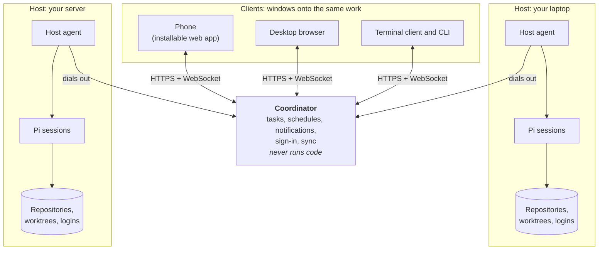
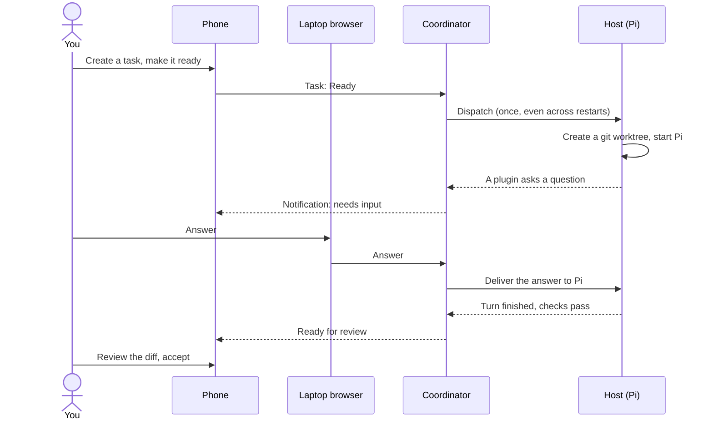

# Switchyard

**Run [Pi](https://github.com/earendil-works/pi) coding agents on your own machines, and drive them from your phone, your browser or your terminal.**

A coding agent has to run where your repositories, toolchains and logins are: your laptop, a workstation, a home server. You, on the other hand, are not always sitting in front of that machine. Switchyard keeps the agents where the work is and lets you follow along from anywhere: start a session from your phone, answer the question it asks while you are on your laptop, take over from a terminal, and get a notification when the result is ready for review. Every client looks at the same live session, and closing one never stops the work.

On top of interactive sessions it adds tasks, a board, scheduled automations and a review flow, so an agent can work through a backlog while you are away and hand everything back for you to accept.

## How it fits together



There are three kinds of parts:

- **The coordinator** is the one always-on service. It keeps tasks, schedules, notifications, devices and the shared view of every session, and it decides what runs where. It never runs an agent and never holds your provider credentials, so it can live anywhere: a container, a small server, or your laptop.
- **Hosts** are your machines. A host agent runs Pi as your OS user, with your repositories, worktrees, Pi packages and model logins, and connects *outbound* to the coordinator. A host needs no open ports, and a laptop can come and go: its sessions keep running while the coordinator is down, and the events catch up when it returns.
- **Clients** are views. The web app works on desktop and as an installed app on a phone; the terminal client and the scriptable CLI work over the same API. Any client can watch, answer and steer a session; none of them owns it.

For a single machine, `switchyard up` runs the coordinator and a host in one process. For more, run the coordinator as a server and enroll each machine as a host. The protocol is the same either way.

## A piece of work, start to finish



1. **You describe the work.** A task has an objective, acceptance criteria, dependencies and a priority. Moving it to Ready lets Switchyard start it.
2. **Switchyard starts it on a host.** The coordinator picks an eligible host, the host creates a git worktree for the task inside the repository (`<repo>/.worktrees/<branch>` by default), and Pi starts there with your normal extensions. A launch is recorded before it is sent, so a lost connection or a coordinator restart never starts it twice.
3. **The agent asks, you answer anywhere.** Questions and approvals from Pi and its plugins appear as cards in every client and as a notification on the device you are most likely to see. Answer once; every client shows the result.
4. **You can step in.** Join from any client to watch and send messages, steer the current turn or queue a follow-up. *Take over* pauses automation (no automatic continuations or retries) until you *return it*. *Stop* aborts the run. Detaching never stops anything.
5. **It ends in Review, not in Done.** When the agent finishes, your configured checks run (tests, linters). If they pass, the task waits in Review with its diff; you can comment line by line, send all comments as one follow-up, request changes or accept. Accepting never merges or pushes for you.
6. **Background work uses the same path.** An automation can open a task on a schedule, from a webhook or when another task finishes, then continue it, append to it, or report only when something changed.

## Features

| Area | What you get |
|---|---|
| **Sessions** | Persistent Pi conversations on any host; the same live session in every client; steer or queue follow-ups; take over and return to automation; resume after crashes with the same conversation (never a silent new one); import existing Pi sessions |
| **Workspaces** | A git worktree per task or session inside the repository, discovery of worktrees you made yourself, setup commands, and removal that refuses to lose uncommitted or unmerged work |
| **Tasks and board** | Backlog, Ready, In progress, Review, Done; dependencies with cycle detection; priorities; per-project concurrency limits; a Now view explaining why queued work waits |
| **Review** | Changed files and diffs on desktop and phone, line comments sent as one follow-up, request changes, accept |
| **Bounded continuation** | Optional: keep the agent working toward an objective, within a maximum number of continuations, a time limit and token or cost caps, ending in your checks and your review |
| **Automations** | Cron (time-zone aware), one-time, webhook and dependency triggers; fresh, continue or watch modes; skip, queue or append when work overlaps; skip or catch up missed runs; a preview of the resulting task |
| **Plugins** | Pi dialogs (select, confirm, input, editor) and extension status and widgets shown in every client; adapters turn specific plugins into structured forms, cards and panels, and plugin packages can ship their own. Terminal-only plugin UI is reported honestly instead of silently dropped |
| **Attention and notifications** | One queue of what needs you (input, failures, reviews); Web Push routed to the device you are using, quiet hours, private previews, one notification per session |
| **Sign-in and devices** | Pair devices by QR code, sign in with passkeys or any OpenID Connect provider; every device has its own revocable credential |
| **Operations** | One container image, SQLite with migrations, backup and restore, health checks, diagnostics, `switchyard doctor` |

## Words used everywhere

| Term | Meaning |
|---|---|
| **Host** | A machine that runs Pi for Switchyard, through its host agent |
| **Project** | A repository Switchyard knows about; a project can have a checkout on several hosts |
| **Workspace** | A working directory for a project: the main checkout or a git worktree |
| **Session** | One persistent Pi conversation in a workspace on a host |
| **Task** | A unit of work on the board, with an objective and acceptance criteria |
| **Run** | One attempt at a task, carried out in a session |
| **Device** | A signed-in client: a browser, an installed web app or a terminal |
| **Adapter** | Code that renders a specific Pi plugin's questions and state as structured UI |

## Quick start

**Try it on one machine** (Node 24 or newer, pnpm, git, and Pi 1.4 or 1.5 on your PATH):

```sh
pnpm i && pnpm build
node packages/cli/dist/main.js up
```

`up` runs the coordinator and a host in one process at `http://localhost:7400`, sets the server up on first start and opens a single-use sign-in link in your browser. Add a project in Settings › Projects (a path to a git repository), then start a session or create a task.

**Run it as a server** with the container image (it runs only the coordinator):

```sh
docker run -d --name switchyard -p 127.0.0.1:7400:7400 -v switchyard-data:/data \
  -e SWITCHYARD_PUBLIC_URL=https://switchyard.example.com \
  ghcr.io/justmytwospence/switchyard:0.2.1
docker exec switchyard switchyard init    # prints a single-use sign-in link for your first device
```

Put HTTPS in front of it (a reverse proxy, or a VPN or tailnet; the installed phone app, notifications and passkeys need HTTPS). Then, on each machine that should run agents, create a host token in Settings › Hosts › Add host and run:

```sh
switchyard host enroll --coordinator https://switchyard.example.com --token <token>
switchyard host install-service    # launchd on macOS, a systemd user service on Linux
```

[docs/deployment.md](docs/deployment.md) has recipes for Caddy, Traefik, nginx and Tailscale, a compose file, and every setting.

## Security model

- **A server is owned before it serves anything.** Ownership comes from `switchyard init` on the server, or from an owner declared in an OpenID Connect configuration. There is never an "unclaimed" web page.
- **Only you add devices.** A new device gets in by a pairing link or QR code made from a device you already use, by a passkey, or by single sign-on that matches the configured owner. Each device has its own credential that you can revoke; signing out of an identity provider never breaks an installed app.
- **Hosts dial out** with their own revocable credentials; the coordinator holds no provider credentials and needs no access to your home directory or Docker socket.
- **Agents run with the host user's privileges.** Running the coordinator in a container does not sandbox the agents; run hosts as a user whose access you are comfortable giving an agent.

Details: [docs/auth.md](docs/auth.md) and the [privilege model](docs/deployment.md#privilege-model).

## Status

Switchyard is young and moving quickly. It is tested against Pi `>=1.4.0 <1.6.0` (see [docs/compatibility.md](docs/compatibility.md) for supported and unsupported Pi capabilities) and runs on macOS and Linux hosts. What has and has not been verified is recorded in [docs/acceptance-report.md](docs/acceptance-report.md).

## Documentation

| Guide | Covers |
|---|---|
| [Deployment](docs/deployment.md) | Single machine, server, reverse proxies, VPNs, hosts, environment reference, privilege model |
| [Sign-in and devices](docs/auth.md) | The owner model, pairing, passkeys, single sign-on, host enrollment, revocation |
| [CLI and terminal client](docs/cli.md) | Every `switchyard` command, credentials, terminal key bindings |
| [Operations](docs/operations.md) | Backup, restore, migrations, retention, logs, health, diagnostics |
| [Adapters](docs/adapters.md) | Rendering a Pi plugin's UI in every client; shipping an adapter with your Pi package |
| [Architecture](docs/architecture.md) | Components, data ownership, the host and client protocols, packages |
| [Development](docs/development.md) | Building, testing (including against real Pi), contributing |
| [Specification](docs/spec.md) | The product specification Switchyard is built to |
