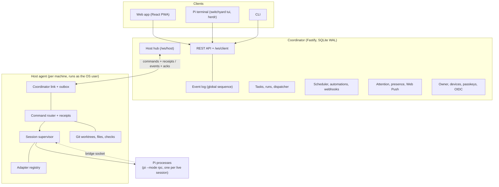

# Architecture

Switchyard has three kinds of components. The [README](../README.md#how-it-fits-together) shows how they fit together in a deployment; this page shows what is inside them.

## Who owns what

| Area | Owner |
|---|---|
| Tasks, automations, dispatch decisions, devices, notifications | Coordinator |
| Pi processes, interactions, filesystem and git state | Host |
| Native conversation history (Pi's session files) | Pi |
| Transcript items for display | Coordinator (a cache built from host events) |

## Reliability rules

- **Ordered, durable events.** Hosts write each event to a local outbox before sending it and resend unacknowledged events after reconnecting. The coordinator assigns one global sequence number; clients reconnect with a cursor and get the missed events or a snapshot. Streaming text is sent live but not stored.
- **Commands run once.** Every command carries an ID, and hosts store receipts, so a resent command returns the stored result. A task launch is recorded before it is sent and carries a dispatch key the host remembers, so a lost reply or a restart never starts work twice. An uncertain launch is reconciled with its host, never moved to another host.
- **Control is versioned.** Taking over a run increments its control revision; hosts reject automated commands that carry an older revision.
- **Interactions are answered once.** An answer must match the interaction's ID and revision; a second answer gets the first one's result.
- **Nothing is replayed after a crash.** An interrupted session keeps its Pi conversation and waits for you to resume it.

## Orchestration and external services

The coordinator persists task hierarchy, agent inbox messages, policy rules and approvals. The host binds bridge requests to the actual session and forwards them over the authenticated host link; Pi does not receive a device token. Task and message creation use tool-call identity for deduplication, but a lost Pi enqueue receipt can leave delivery uncertain: execution is not exactly once. See [policies.md](policies.md).

GitHub operations run on the workspace host using its `gh` login; the coordinator stores snapshots, not GitHub tokens. See [github.md](github.md).

## Pi integration

Each live session is one Pi process: by default interactive Pi in a terminal holder, controlled through an extension ([terminal-sessions.md](terminal-sessions.md)); as a fallback, `pi --mode rpc`, spoken to over JSON lines on stdin and stdout. Switchyard also loads a small bridge extension into every Pi it starts; it reports when an extension opens a dialog, including terminal-only dialogs that RPC mode cannot show, so Switchyard can say so instead of hiding it. Supported capabilities and known limits are listed in [compatibility.md](compatibility.md).

## Packages

| Package | Role |
|---|---|
| `protocol` | Shared zod schemas and types: entities, events, host and client wire formats, REST API |
| `pi-runtime` | Pi RPC client, session runtime, version gate and the bridge extension |
| `adapter-sdk` | Adapter manifest, hooks, registry and portable UI components |
| `adapter-examples` | An example adapter for adapter authors |
| `host-agent` | The host agent: Pi supervisor, worktrees, outbox, dispatch, enrollment |
| `coordinator` | The coordinator: sign-in, tasks, scheduler, attention, push, operations |
| `web` | The web app (desktop and mobile layouts) |
| `terminal` | Coordinator client library: REST, live sync, the Pi terminal relay client |
| `cli` | The `switchyard` command |
| `test-fixtures` | Mock model and identity provider, isolated Pi environments for tests |
